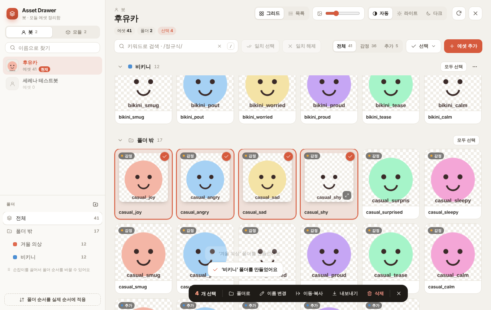
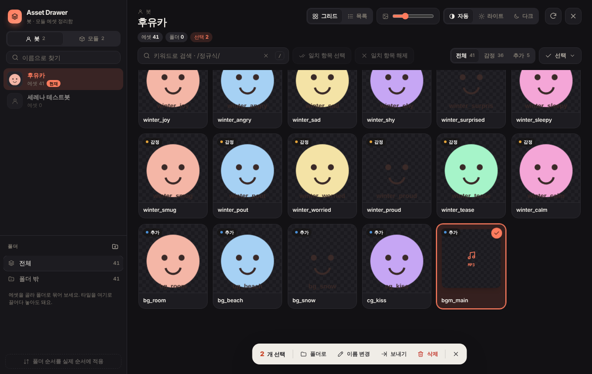
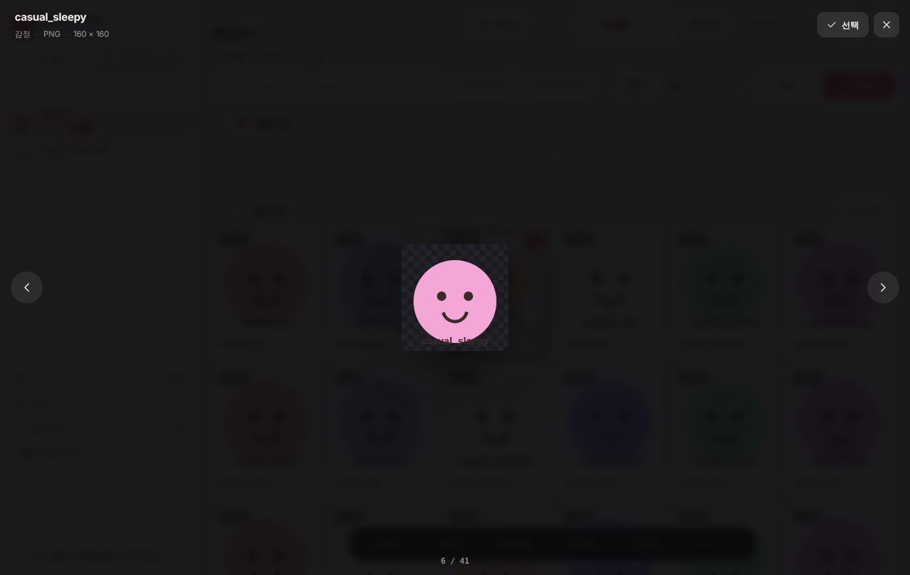
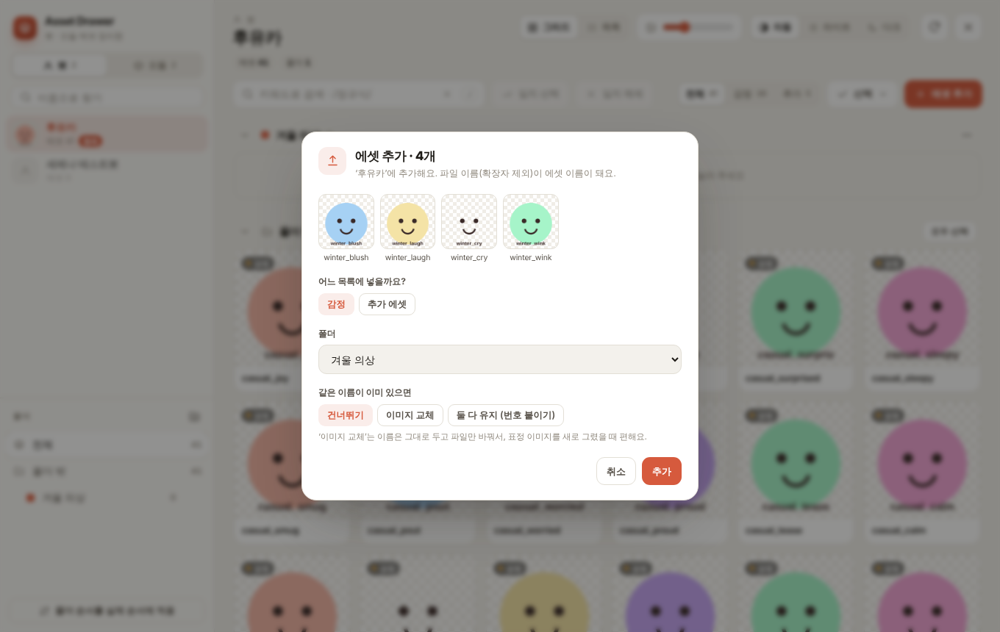
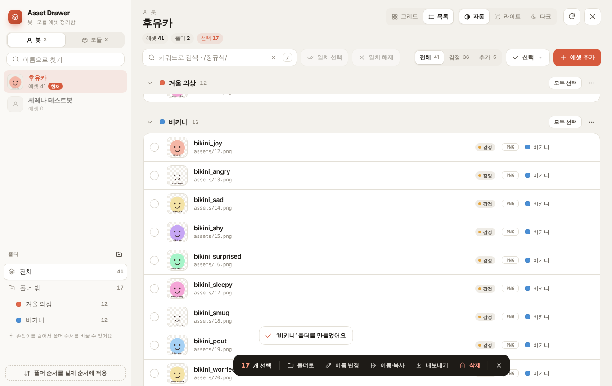
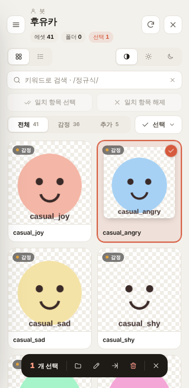

# Asset Drawer

**RisuAI용 에셋 서랍 플러그인.** RisuAI에 임포트된 **봇(감정 · 추가 에셋)** 과 **모듈 에셋**을 한 화면에서 정리하는 플러그인입니다.
그리드와 목록으로 에셋을 훑어보고, 칸을 눌러 고르고, 키워드로 한꺼번에 선택하고, 폴더로 묶고, 봇과 모듈 사이로 끌어다 옮길 수 있어요.

| 라이트 · 그리드 | 다크 · 그리드 |
| --- | --- |
|  |  |

| 크게 보기 | 에셋 추가 |
| --- | --- |
|  |  |

| 목록 보기 | 모바일 |
| --- | --- |
|  |  |

## 기능

**보기와 선택**
- **두 가지 보기** — 썸네일을 크게 보는 그리드, 경로 · 확장자 · 폴더까지 보이는 목록. 그리드는 썸네일 크기 조절 가능
- **크게 보기** — 원본 크기와 해상도 확인, 이전 · 다음 넘기기, 그 자리에서 선택. 영상 · 오디오는 바로 재생
- **칸을 눌러 선택** — 체크박스 없이 에셋 칸을 누르면 선택, `Shift`+클릭으로 범위 선택
- **검색 일괄 선택** — 키워드(띄어쓰기로 여러 단어) 또는 `/정규식/`으로 찾고, 일치 항목을 한 번에 선택 · 해제
- **일괄 선택 메뉴** — 폴더 안까지 포함한 전체 선택, 폴더 밖 에셋만 선택, 폴더 안 에셋만 선택, 반전, 해제

**정리**
- **폴더** — 이름 · 색상 지정, 접기, 에셋을 끌어다 넣기, 손잡이를 끌어서 폴더 순서 바꾸기
- **폴더 순서를 실제 순서에 적용** — 리스 안의 에셋 배열을 폴더 순서대로 다시 정렬
- **이름 변경** — 한 개는 바로 고치기(크게 보기에서도 가능), 여러 개는 키워드 바꾸기 · 지우기 · 넣기(맨 앞 · 맨 뒤 · 특정 글자 앞뒤), 번호 매기기, 대소문자 변환. 미리보기와 중복 이름 경고 제공

**추가 · 이동 · 내보내기**
- **에셋 추가** — 파일을 고르거나 화면으로 끌어다 놓기. 감정 / 추가 목록과 폴더를 고르고, 같은 이름은 건너뛰기 · 이미지 교체 · 둘 다 유지 중에서 선택
- **봇 · 모듈 간 이동 · 복사** — 에셋을 사이드바의 다른 봇이나 모듈로 끌어다 놓거나 액션 바에서 실행. 폴더 구조 유지, 같은 이름 건너뛰기
- **내보내기** — 한 개는 파일 그대로, 여러 개는 zip으로. 폴더 · 감정/추가 구조대로 묶기 가능
- **삭제** — 선택한 에셋을 확인 후 삭제

**그 밖에**
- **테마** — 라이트 / 다크 / 자동(리스 테마 따라가기)
- **모바일 레이아웃** — 좁은 화면에서는 사이드바가 서랍처럼 열림, 크게 보기에서 밀어서 넘기기
- 이미지뿐 아니라 영상 · 오디오 에셋도 형식을 판별해서 보여줍니다.

## 설치

1. [`asset_drawer.js`](asset_drawer.js)를 내려받습니다.
2. 리스 **설정 → 플러그인 → 플러그인 불러오기**에서 파일을 선택합니다.
3. 설정 메뉴나 햄버거 메뉴의 **Asset Drawer**를 눌러 엽니다.
4. 처음 열 때 나오는 데이터베이스 접근 요청을 허용합니다.

RisuAI 플러그인 API **3.0**이 필요합니다. PocketRisu에서도 같은 방법으로 설치할 수 있어요.

### 업데이트

플러그인에 업데이트 주소가 들어 있어서, 새 버전이 올라오면 리스 · 포켓리스의 플러그인 설정 화면에 업데이트 표시가 뜹니다. 눌러서 바로 업데이트하면 돼요. 폴더 구성과 설정은 그대로 유지됩니다.

## 사용법

| 동작 | 방법 |
| --- | --- |
| 에셋 선택 / 해제 | 에셋 칸 클릭 |
| 범위 선택 | 첫 칸 클릭 후 `Shift`+클릭 |
| 크게 보기 | 칸의 확대 버튼 또는 더블클릭 |
| 크게 보기에서 넘기기 · 선택 | `←` `→` · `Space` (모바일은 좌우로 밀기) |
| 이름 고치기 | 선택 후 `F2`, 크게 보기에서는 이름 옆 연필 버튼이나 `F2` |
| 폴더에 넣기 | 에셋을 사이드바 폴더나 폴더 섹션으로 끌어다 놓기 |
| 다른 봇 · 모듈로 옮기기 | 에셋을 사이드바의 봇 · 모듈로 끌어다 놓기 (탭 위에 올리면 탭 전환) |
| 폴더 순서 바꾸기 | 사이드바 폴더 왼쪽 손잡이를 끌기 |
| 에셋 추가 | `에셋 추가` 버튼 또는 파일을 화면으로 끌어다 놓기 |
| 검색창으로 이동 | `/` |
| 보이는 에셋 모두 선택 | `Ctrl`/`Cmd`+`A` |
| 선택한 에셋 삭제 | `Delete` 또는 `Backspace` |
| 선택 해제 → 창 닫기 | `Esc` |

선택하면 화면 아래에 액션 바가 나타나고, 여기서 폴더로 옮기기 · 이름 변경 · 이동 · 복사 · 내보내기 · 삭제를 할 수 있어요.

## 알아둘 점

- **폴더 정보는 플러그인 저장소에 저장됩니다.** 봇이나 모듈 파일 자체에는 들어가지 않아서, 봇을 내보내도 폴더는 따라가지 않습니다. 폴더 구성을 실제 에셋 순서로 남기고 싶다면 *폴더 순서를 실제 순서에 적용*을 사용하세요.
- **감정 에셋 이름을 바꾸면** 그 이름을 참조하는 로어북 · 정규식 · 프롬프트도 함께 고쳐야 할 수 있어요.
- **이동 · 복사**는 같은 파일을 가리키는 항목만 옮기므로 저장 공간을 더 쓰지 않습니다.
- 추가, 삭제, 이름 변경, 이동, 순서 적용은 리스 데이터를 직접 바꿉니다. 큰 작업 전에는 백업을 권장해요.

## 개발

리스 없이 [`dev/harness.html`](dev/harness.html)을 브라우저로 열면 가짜 봇 · 모듈 데이터로 플러그인을 바로 띄워 볼 수 있습니다. `risuai` API를 흉내 낸 모의 객체가 들어 있어서 UI와 데이터 변경을 확인할 때 편해요.

## 라이선스

[MIT](LICENSE)
